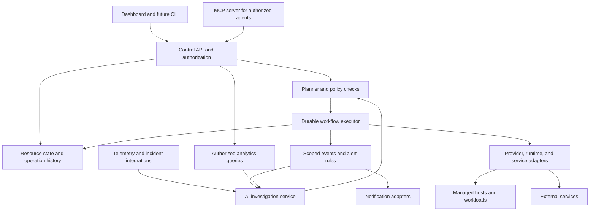

# Proposed architecture

**Status: proposal.** Component boundaries are described here; programming languages, frameworks, persistence technology, and wire protocols remain open decisions.

All component choices must satisfy the [open-source and open-standards policy](open-source-and-standards.md). Use OCI contracts for applicable container boundaries, OpenAPI for HTTP API descriptions, and OpenTelemetry/OTLP for applicable telemetry. Provider-specific behavior belongs behind adapters. The self-hosted core must operate without a proprietary control plane or model API.

## Components

The control plane records intent, checks authority, constructs plans, and tracks execution. Adapters translate supported operations into provider or service actions. A host execution component may perform local work; its transport and deployment model require a technical decision.

On one VPS, logical components may run together. Separate services should be introduced only when isolation, scaling, or reliability requirements justify them.

## Agent and event interfaces

MCP, event ingestion, alert evaluation, analytics, and notification adapters are cross-cutting interfaces described in [agents, events, and analytics](agents-events-and-analytics.md). They share resource identities and authorization. An MCP server exposes platform capabilities; optional outbound MCP clients connect external tools through scoped integrations. These logical boundaries do not require separate processes or a distributed message broker on the initial VPS.

## Resource model

| Resource | Responsibility |
| --- | --- |
| Project | Ownership boundary for related applications and operational context. |
| Environment | A configuration and deployment target such as development or production. |
| Host | A machine with discovered capabilities, capacity, and connection status. |
| Application | A deployable workload and its dependencies. |
| Release | An immutable artifact reference and configuration revision, with optional source/build provenance. |
| Source binding | A source connection and capability set; version-control and hosting features are optional. |
| Build | Pinned source snapshot and build inputs, builder identity, and resulting artifact provenance. |
| Service binding | A managed or external dependency, its connection reference, and capabilities. |
| Worker / scheduled job | Background execution configuration and coordination policy. |
| Operation | A recorded plan, execution state, checkpoints, verification, and failure information. |
| Backup | An artifact reference with provenance, compatibility, retention, and restore evidence. |
| Incident | A report or alert linked to evidence, investigation, and related operations. |
| Extension | An integration with a versioned contract and declared permissions. |

Secrets should be referenced by identifier rather than copied into resource documents, logs, or plans. The chosen secret store and encryption model are open decisions.

## Desired and observed state

Store intended configuration separately from observed infrastructure state. Observations need timestamps and provenance so that a plan can reject stale assumptions.

An operation should:

1. Resolve its target resources and dependency graph.
2. Read current state and validate capabilities.
3. Produce an inspectable plan with preconditions and expected effects.
4. Check policy and bind approval to the specific plan revision where required.
5. Execute steps with durable checkpoints and bounded retries.
6. Verify results and record the resulting state.

Changes to material inputs invalidate an approved plan. Concurrent changes to the same resource require coordination. A retry must inspect actual state before repeating a step whose outcome is uncertain.

## Extension contracts

Proposed extension categories include source/version-control providers, repository hosting, builders, artifact stores, infrastructure providers, execution runtimes, services, observability, AI models, workflows, and dashboard widgets. Source acquisition and deployment are separate contracts; see [sources and artifacts](sources-and-artifacts.md). Git-specific concepts must not be required fields in the core resource model.

Every operational adapter should declare:

- Identity, version, supported contract versions, and supported service versions.
- Required credentials, network access, and permission scope.
- Available capabilities such as inspect, provision, configure, backup, restore, or migrate.
- Preconditions, expected effects, timeouts, retry behavior, and verification methods.
- Whether an action is reversible and what compensation is possible.
- Structured errors that distinguish rejected requests, transient failures, and uncertain outcomes.

Capability declarations should be validated through conformance tests before publication as supported integrations. An adapter must not advertise migration solely because it supports connecting to a service.

The first implementation can use built-in adapters behind these interfaces. Dynamic loading, third-party packaging, discovery, signing, and sandboxing can follow after the contracts have been exercised.

## Managed and external services

A managed service grants the platform specific lifecycle authority. An external binding initially grants only the declared connection and observation capabilities. Provisioning, deletion, backup, and migration are unavailable unless explicitly supported and authorized.

Dependency relationships should identify shared services and consumers. Deleting or moving a service requires checking affected bindings. Credentials for a binding should be scoped to its actual purpose.

## Trust and failure boundaries

The dashboard, AI integration, and adapters must not bypass API authorization. Host access needs authenticated communication, scoped credentials, and a revocation path. Installing an extension introduces executable code or remote access and therefore requires a defined trust model before third-party extensions are supported.

An unavailable control plane should not, by itself, stop already-running application workloads. On recovery, the executor must reconcile recorded checkpoints against infrastructure state before resuming work. Scheduling behavior during outages must be explicit to avoid accidental duplicate execution.

In a single-host installation, losing that host may also lose the control plane. Recovery therefore needs off-host backups of relevant control state and a documented bootstrap path, alongside application data backups.

## Deferred design choices

See [engineering decisions](engineering.md) for stack, execution transport, workflow persistence, tenancy, and extension isolation decisions. These are prerequisites for implementation, not details silently assumed by this diagram.
